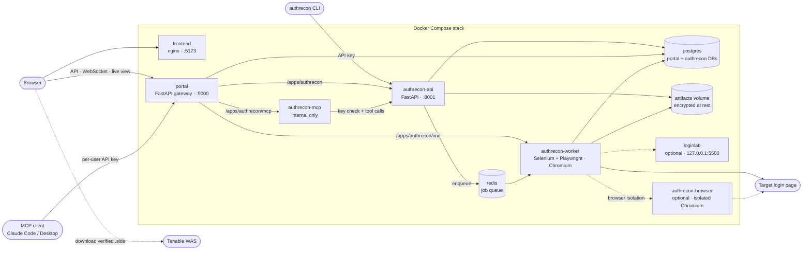

# AuthRecon Suite

AuthRecon works out how a web application's login works, logs in the way a scanner would, and gives you a verified Selenium `.side` login script plus the settings to paste into **Tenable Web App Scanning (WAS)**. The run also records what happened (timeline, screenshots, HAR, cookie and header findings) so you can troubleshoot a login that won't automate.

Self-hosted, runs in Docker, no cloud services. Version: see [`VERSION`](./VERSION).

> **Authorized testing only.** Point AuthRecon only at systems you are allowed to test. Provided as-is, without warranty; see [LICENSE](./LICENSE).

## Quick start

Prerequisites: Docker 23.0+ with Compose 2.17+, `git`, `python3`, `openssl`, `curl`, 8 GB RAM, 10 GB free disk.
- **Linux:** Docker Engine + the compose plugin.
- **macOS (Intel or Apple Silicon):** Docker Desktop with at least 8 GB of memory (Settings › Resources). `git` and `python3` come with the Xcode Command Line Tools (`xcode-select --install`).
- **Corporate network:** if your network inspects TLS or blocks public package registries, the installer detects it and tells you what to pass: `--ca-file` for a corporate root certificate, `--pip-index`/`--npmrc` for a private mirror. See [Corporate networks](./ADMIN_GUIDE.md#corporate-networks-tls-inspection-and-private-mirrors).

```bash
git clone https://github.com/AuthRecon/AuthRecon.git
cd AuthRecon
./install.sh          # use sudo only if your user isn't in the docker group
```

The installer asks for the address you'll browse to, generates unique secrets, builds and starts the stack, and checks it's healthy. Then:

1. Open `http://<your-host>:5173/setup` and create the admin account.
2. *(Optional, practice targets)* `docker compose --profile loginlab up -d loginlab`, then **Settings › LoginLab** → enable it for a set time.
3. **AuthRecon › New Run**: enter the login URL and a test account (or a stored credential). For LoginLab try `http://loginlab:5500/form-login` with `testuser@loginlab.local` / `TestPass123!`.
4. When the run succeeds, the run page opens with the **Tenable WAS setup** card: login page, page to verify, pattern to verify (regex) and the `.side` script. Below it, **Scan readiness** grades how well this login will scan (does the session survive on cookies alone, how long it lasts, WAF or rate limits) and gives starting scan settings: URLs to exclude, the session cookie, performance tweaks.
5. Click **Verify**. AuthRecon replays the script in a clean browser, the same way WAS does. (This counts as one more login on the account.)
6. Download the `.side` and enter the card's values in your WAS scan's *Selenium authentication* settings.

## What it handles

| Login type | Status |
|---|---|
| Form login (incl. JavaScript-rendered), two-step (username then password), HTTP Basic | Automated; tested end to end against LoginLab |
| Azure AD, Okta, SAML/ADFS, LDAP-style forms, OAuth/OIDC redirects | Automated (dedicated handlers); test against your own IdP before relying on it |
| Windows Integrated (Kerberos/NTLM), HTTP Digest | Detected; the run explains how to configure WAS for them, no `.side` produced |
| MFA on the target, CAPTCHA/bot checks, client certificates, WebAuthn | Not supported; the run fails with screenshots of where it stopped |

When a form login can't be found, a connected AI client can read the sanitized page and suggest selectors for a rerun (see *AI via MCP* below).

Also included:
- **Multi-role runs:** several accounts in one run, each with its own artifacts.
- **Manual recording:** a live browser in your browser (noVNC) for flows you have to drive by hand.
- **Exports:** HAR, curl, Postman, Burp and ZAP from the captured session.
- **Scan Analyzer (preview):** upload a WAS scan's debug zip or JSON export after a failed or thin scan; it explains what went wrong (logged out, timeouts, WAF, URLs skipped and why) and lists the settings to change. Rules only, no AI needed.
- **Secondary tools:** Atlas (a map of targets your runs touched), Network Tools (ping/traceroute/DNS from the server).
- **LoginLab:** practice targets inside the stack (form, two-step, Basic, JSON API, SSO-style redirect, LDAP-style, form + domain, and a deliberately hard "covert" form), plus Microsoft/Okta/Google look-alike demo pages. Off by default, loopback-only.

## Architecture



Every browser request goes through the portal, which handles login, sessions and per-user checks. The API queues each run on Redis; the worker drives a real Chromium against the target, then writes the timeline, screenshots, HAR and `.side` (encrypted) and the run record. The MCP server holds no credentials: each AI client uses its own user's API key, and an admin has to switch MCP on.

| Port | Service | Notes |
|---|---|---|
| 5173 | frontend | Web UI |
| 9000 | portal | All UI traffic, MCP endpoint (`/apps/authrecon/mcp`) |
| 8001 | authrecon-api | Direct API/CLI access. Firewall it; see [ADMIN_GUIDE](./ADMIN_GUIDE.md#network-exposure) |
| 127.0.0.1:5500 | loginlab | Only while LoginLab is enabled |

## Security at a glance

Stored credentials and run artifacts are encrypted, and each stored credential is bound to the domains it may be used on; the worker never types a password on an unexpected site. Targets are checked so a run cannot reach cloud metadata or AuthRecon's own services, and with browser isolation on, the browsers run in a container with no secrets and no database access. Sign-in supports two-factor authentication, sessions are HttpOnly cookies that page scripts cannot read, and the UI runs under a strict Content-Security-Policy. Details and known limitations: [SECURITY.md](./SECURITY.md).

## AI via MCP (optional)

AuthRecon has no built-in LLM. To use AI, connect your own MCP client (Claude Code, Claude Desktop, ...) in **Settings › AI & MCP**. An admin switches MCP on, you create a key there, and the page gives you a ready-to-paste client command. The client can then list and launch runs (stored credentials only, never a raw password), read timelines, fetch the WAS settings, trigger Verify, and suggest selectors for stuck form logins. It never receives credentials or `.side` contents. Details: [SECURITY.md](./SECURITY.md#ai-and-mcp).

## Documentation

- [ADMIN_GUIDE.md](./ADMIN_GUIDE.md): install, upgrade, backup, secrets, TLS, network exposure, CLI, troubleshooting
- [SECURITY.md](./SECURITY.md): how data is protected, AI/MCP rules, reporting vulnerabilities
- [CONTRIBUTING.md](./CONTRIBUTING.md): layout, development setup, tests, adding a login pattern

## Acknowledgments

- Built with extensive help from AI coding assistants (Claude Code, Codex, ChatGPT).
- [The Internet](https://the-internet.herokuapp.com/), Dave Haeffner's collection of web UI test pages, has been a long-standing test target for login flows.

## License

Copyright 2024-2026 The AuthRecon Authors. Licensed under the Apache License 2.0; see [LICENSE](./LICENSE) and [THIRD_PARTY_NOTICES.txt](./THIRD_PARTY_NOTICES.txt). Every feature is free. The in-app licensing module is off by default and never limits anything (see [ADMIN_GUIDE](./ADMIN_GUIDE.md#licensing)).
