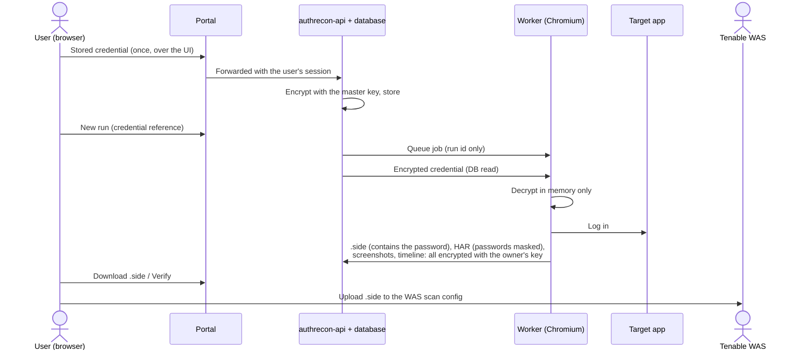

# Security

AuthRecon stores working credentials for the applications you test and drives a real browser with them, so it is built to keep those credentials in as few places as possible. This page describes what the code does today.

## Reporting a vulnerability

Please don't open a public issue. Use GitHub's **private vulnerability reporting** on this repository, with steps to reproduce and the version (`VERSION` file).

## Where credentials go

- **Stored credentials** are encrypted with the AuthRecon master key (`SECRET_KEY`). They are shown again only to their owner.
- **Run artifacts** (screenshots, HTML, HAR, `.side`, exports) are encrypted at rest with a per-user key, which is itself wrapped by the master key. They are decrypted only for the run's owner or an admin.
- **HAR files** have password values replaced with `[REDACTED]` before storage. Credentials embedded in URLs (`user:pass@host`) are stripped from stored URLs.
- **`.side` files contain the plaintext password by design**, because Tenable WAS replays them literally. Treat a downloaded `.side` like the password itself.
- **Timeline events and logs** never contain passwords, cookies or tokens.
- **Stored credentials are bound to domains.** A credential is used only on the hosts listed for it (bound to the first run's host if none are set), and the worker checks the page right before typing a password: only the target's own domain, the credential's domains and known identity providers. A redirect to anywhere else, or an AI client steered by a hostile page, cannot send a real password to another site.
- Passwords and API keys are stored as bcrypt hashes. Every service refuses to start with a missing or default secret.
- Users see a security notice about handling these artifacts on first login and again every 7 days.

## Access control

- **Sign-in:** password, then a TOTP code for users with two-factor on. The password step alone never yields a session: it returns a 5-minute single-use token that only the code step accepts. Five wrong codes end that sign-in, codes cannot be replayed, attempts are throttled per address, and backup codes are stored hashed. When two-factor is required for admins, an admin without it gets a session that only reaches the two-factor setup.

- **Web sessions are HttpOnly cookies** (`SameSite=Strict`, `Secure` over HTTPS). No session or API token is stored where the page's scripts can read it, so a cross-site scripting bug cannot steal one; the AuthRecon API token is also a cookie the portal turns into the request header. Requests authenticated by cookie must carry an `X-Requested-With` header, which other sites cannot add, as protection against cross-site request forgery. The UI also runs under a strict Content-Security-Policy.
- All UI and MCP traffic goes through the portal, which authenticates the user on every request.
- Every run, artifact, credential and playbook endpoint checks that the caller is the owner or an admin.
- API keys (`ak_live_…`) belong to one user, can be given an expiry, and can be revoked; an admin decides who may create them.
- Port 8001 (authrecon-api) is reachable without going through the portal. Firewall it as described in [ADMIN_GUIDE.md](./ADMIN_GUIDE.md#network-exposure).
- Live browser views (VNC) are per run and only reachable through the portal's authenticated proxy.

## AI and MCP

AuthRecon contains **no LLM and no AI provider settings**. AI means a user's own MCP client (Claude Code, Claude Desktop, ...) connected through **Settings › AI & MCP**. The rules:

1. **Everything works without AI.** Detection, playbooks and artifacts are deterministic.
2. **An admin switch** turns MCP on; it is off by default.
3. **Per-user keys:** the client acts as the key's user and sees only that user's data.
4. **The model never sees or sets a credential.**
   - `submit_run` accepts only a stored `credential_id`; it has no username or password parameter.
   - `list_credentials` returns labels, never secrets.
   - `.side` contents, cookies and artifact downloads are not available through any tool.
   - Tool results are built from allow-listed fields, and anything secret-shaped is redacted as a backstop.
5. **The model only suggests.** For a stuck form login, `get_stuck_run_context` returns the page HTML after it passes through `ai_fallback/sanitize.py`, which removes password and credential-like input values, scripts, styles and token-shaped strings, and caps the size. `submit_login_suggestion` records selectors. They are used only on a rerun, by the normal automation, and only if the run owner turned on *Use AI login suggestions in my runs*.
6. **Page content is untrusted data**, never instructions.

Be aware of what this means in practice:
- The sanitized HTML of a stuck page **is sent to whatever model your MCP client uses**. If that is a cloud model, the target's page content leaves your network. Choose your client and model accordingly.
- **Read-only keys:** a key created as *read-only* can list and inspect but is refused on every write (submit, cancel, rerun, verify, settings). Give an AI client a read-only key when it only needs to look.
- **Approval for AI-started runs** (admin setting): runs an MCP client submits wait until a person clicks **Approve** on the run page; approval works only in the web UI, never with an API key. Detection (which sends no credentials) still runs at submission. Other state-changing tools (`cancel_run`, `clear_playbook…`) are not held; whether you are asked before each call depends on your MCP client's approval settings. Revoke the key or switch MCP off to stop a client immediately.

## Supply chain

Every pull request runs the unit tests plus `pip-audit` on each Python service, `npm audit` on the browser bundle, and a gitleaks secret scan; GitHub Actions are pinned to commit SHAs, and Dependabot proposes dependency updates. The UI bundles its own fonts and loads nothing from third-party hosts.

## Untrusted target pages

The worker deliberately visits sites it does not trust. To limit what a hostile page (or a mistaken target) can do:
- **Target guard:** cloud metadata, loopback, link-local addresses, the Docker host and AuthRecon's own services are refused as targets: at submission, at run start, on every detection redirect, and inside the browser for every request a page's scripts make. Private ranges stay allowed for internal scanning ([ADMIN_GUIDE.md](./ADMIN_GUIDE.md#which-targets-authrecon-may-visit)).
- **Downloads are blocked** in every browser AuthRecon drives.
- **Browser isolation** (opt-in, recommended): browsers that visit targets, including the live view and manual recording, run in a separate `authrecon-browser` container that holds no AuthRecon secrets and cannot reach the database, Redis or MCP.
- **The worker and API containers** run as a non-root user with all Linux capabilities dropped, `no-new-privileges`, and memory and process limits.

## Known limitations

These are known gaps, not oversights. Plan your deployment around them:
- **Two-factor authentication is per user** (TOTP, with backup codes) and can be required for admins ([ADMIN_GUIDE.md](./ADMIN_GUIDE.md#two-factor-authentication)). It is not required for operators; there is no SSO login for AuthRecon itself yet.
- **HttpOnly cookies stop token theft, not misuse while the page is open.** A cross-site scripting bug could still act as the signed-in user (for example create an API key) for as long as the page stays open. The Content-Security-Policy is the main defence against that. Treat the UI origin as sensitive.
- **Port 8001 skips the portal.** The API still requires a key or token, but the portal's per-request checks and audit trail don't apply there. Firewall it (see [ADMIN_GUIDE.md](./ADMIN_GUIDE.md#network-exposure)).
- **`.side` files contain plaintext passwords** because Tenable WAS needs them. Anyone holding the file holds the password.
- **SSO handlers (Azure AD, Okta, SAML/ADFS, OAuth) are not tested against live identity providers.** Use **Verify** before relying on a script.
- **Without browser isolation, the browser runs without Chrome's sandbox in the worker that holds the master key.** A browser exploit on a hostile target page would reach the worker's secrets. Turn on [browser isolation](./ADMIN_GUIDE.md#browser-isolation-recommended): browsers then run in a container with no AuthRecon secrets and no database access.

## LoginLab

LoginLab is **intentionally vulnerable**. It runs only when its Compose profile is started, binds to `127.0.0.1`, checks the Host header against an allow-list of the AuthRecon services, uses its own token (never the main service secret), and switches itself off when its enable window expires. Never publish it.
